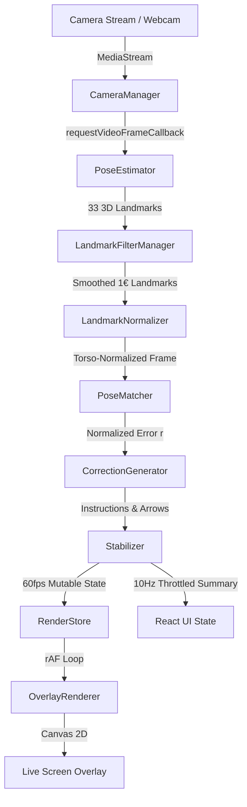

# Pose Coach - System Architecture

## 1. System Overview & Philosophy
**Pose Coach** is a local, privacy-first desktop application engineered to turn a standard laptop or USB webcam into an intelligent personal pose coach. Rather than serving as a skeletal debugging demo, it delivers an intuitive user experience with live video feedback, target pose comparison, and precise biomechanical corrections.

---

## 2. Technical Stack
- **Framework & Host:** Electron (Chromium runtime) with strict process isolation. The same renderer runs on localhost in Chrome and Edge for rapid iteration.
- **Frontend Architecture:** React 18 with TypeScript and Tailwind CSS.
- **Icons & Typography:** `lucide-react`, `@fontsource/inter` (bundled locally, zero CDN dependency).
- **Computer Vision & Pose Estimator:** Google MediaPipe Pose Landmarker running self-hosted `.task` model bundles (`pose_landmarker_full.task` and `pose_landmarker_lite.task`) and self-hosted WebAssembly (WASM).
- **Testing & Quality Assurance:** Vitest for unit testing and Playwright for end-to-end browser automation.
- **Dataset Tooling:** Python 3.10+ scripts for dataset audit, perceptual hashing, and metric extraction under `tools/dataset/`.

---

## 3. High-Level Modular Architecture



### Core Engine Modules:
1. **`CameraManager` (`src/renderer/core/camera/cameraManager.ts`):**
   - Handles webcam lifecycle: permissions, start, pause, resume, stop.
   - Hot-plugs USB cameras via the `devicechange` event without app restarts.
   - Probes hardware resolution support (1080p, 720p, 480p) via media constraints.
   - Releases every track immediately upon stop, pause, or window closure.

2. **`PoseEstimator` (`src/renderer/core/pose/poseEstimator.ts`):**
   - Self-hosts MediaPipe Pose Landmarker with WebAssembly.
   - Configures 2-person detection to monitor background clutter.
   - Selects primary person based on bounding box area and centrality with sticky hysteresis.

3. **`LandmarkFilterManager` (`src/renderer/core/pose/landmarkFilter.ts`):**
   - Implements the 1€ (One Euro) Filter with dynamic speed-adaptive cutoff frequencies.
   - Includes Exponential Moving Average (EMA) as a low-overhead fallback.
   - Reduces raw webcam coordinate jitter by >50% while adding <80ms latency.

4. **`LandmarkNormalizer` (`src/renderer/core/geometry/normalizer.ts`):**
   - Translates origin to mid-hip (falling back to mid-shoulder for upper-body framing).
   - Scales distances by torso length (mid-shoulder to mid-hip), falling back to shoulder width multiplied by 1.45.
   - Preserves angular tilt to evaluate spinal posture and shoulder balance.

5. **`PoseMatcher` (`src/renderer/core/matching/poseMatcher.ts`):**
   - Calculates normalized error $r = |\Delta| / \text{tolerance}$ and feature score $s = 1 / (1 + r^2)$.
   - Weighted mean score over visible joints with visibility-weighted confidence.
   - Enforces 70% required landmark coverage gate.
   - Hysteresis: Matched achieved at $\ge 85\%$ held for 1.5 seconds; broken only if $< 75\%$ or critical $r > 2.0$ for 0.5s.
   - Strict vs Allow-Mirrored modes with anatomical symmetry swapping.

6. **`CorrectionGenerator` (`src/renderer/core/guidance/correctionGenerator.ts`):**
   - Prioritizes errors by weight $\times r \times (1.5 \text{ if critical})$.
   - Merges redundant limb features into unified instructions.
   - Limits output to 1 primary and up to 2 secondary corrections.
   - Uses short imperative templates ($\le 8$ words).
   - Stabilizes advice with 400ms onset persistence, 1.2s display hold, and clearing at $r < 0.8$.
   - Routes directional guidance arrows away from the face.

7. **`Coordinates` (`src/renderer/core/render/coordinates.ts`):**
   - Unified transformation function mapping normalized [0, 1] coordinates to screen canvas.
   - Handles DPR scaling, object-fit (`contain` and `cover`), letterbox offsets, and mirror flips.

8. **`OverlayRenderer` (`src/renderer/core/render/overlayRenderer.ts`):**
   - Multi-layered canvas rendering running in `requestAnimationFrame` at 60 fps.
   - Three distinct joint shapes/colors: Mint Cyan (detected), Warm Amber (needs correction), Fresh Green (aligned).
   - Dark halo underneath all strokes ensuring legibility across light and dark backgrounds.

9. **`PerformanceMonitor` (`src/renderer/core/perf/performanceMonitor.ts`):**
   - Monitors render FPS, inference latency, and p95 benchmarks.
   - Automatically signals degraded mode if p95 latency exceeds 50ms for 5 seconds.

---

## 4. Electron Security Hardening
Pose Coach enforces modern Electron security best practices:
- `contextIsolation: true`
- `nodeIntegration: false`
- `sandbox: true`
- **Strict Content Security Policy (CSP):**
  ```http
  default-src 'self';
  script-src 'self' 'wasm-unsafe-eval';
  worker-src blob:;
  style-src 'self' 'unsafe-inline';
  img-src 'self' data: blob:;
  connect-src 'self' blob:;
  media-src 'self' blob: mediastream:;
  ```
- **Permission Request Filtering:** Grants only `media` permissions, and only to verified app origins (`localhost:5173` or local packaged files).
- **Navigation Lock:** External URL navigation and `window.open` calls are blocked.
